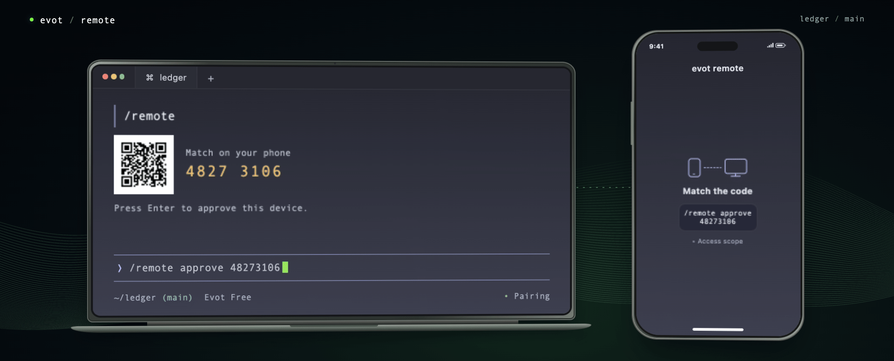

<p align="center"><strong>Evot</strong></p>
<p align="center"><strong>The lightest harness for agentic work.</strong></p>
<p align="center">An open-source terminal coding agent. A short prompt, four core tools, and the model does the thinking.</p>

<p align="center">
  <a href=".github/assets/demo.gif"></a>
</p>

## News

- **2026-11-24** `/remote` — scan a QR code to follow, steer and resume your sessions on this machine (macOS or Linux) from your phone; type `/` for command and installed-skill suggestions, and tap a match to complete it. The phone composer shows `Tab` when it can complete a command, offer a suggestion, or queue a follow-up (`Send after`); `Esc` dismisses, pulls back or interrupts. Return on the phone keyboard inserts a newline. Sessions show local calendar dates, and tapping a photo thumbnail opens a larger preview. Pending prompts appear above the composer as in the TUI: `[now]` steers at the next opportunity, `[after]` waits for the turn to finish, and `[paused]` stays queued. Only consumed prompts enter the transcript. Steering releases shell waits automatically. New devices are approved in the TUI.
- **2026-11-03** `/compute` — add your ssh machines; the agent runs commands and long jobs on them for you.
- **2026-10-18** `Tab` — context-aware suggestions, e.g. “Run the tests.” `Tab` cycles; `→` accepts without sending.

## Quick start

```bash
curl -fsSL https://evot.ai/install | sh
```

The installer configures your PATH. Open a new terminal, or run the command it prints to use evot in the current terminal. Then log in:

```bash
evot login
```

Login opens the TUI. Use hosted models or bring your own API keys.

<details>
<summary>Build from source</summary>

```bash
git clone https://github.com/evotai/evot.git
cd evot
make setup && make install
```

</details>

<details>
<summary>Bring your own models</summary>

Configure providers in `~/.evotai/evot.env`. Examples:

```env
# Anthropic
EVOT_LLM_ANTHROPIC_API_KEY=sk-ant-...
EVOT_LLM_ANTHROPIC_BASE_URL=your-anthropic-base-url
EVOT_LLM_ANTHROPIC_MODEL=claude-opus-4.8

# OpenAI Responses API
# EVOT_LLM_OPENAI_API_KEY=sk-...
# EVOT_LLM_OPENAI_MODEL=gpt-5.6-sol
# EVOT_LLM_OPENAI_PROTOCOL=openai_responses

# DeepSeek (Anthropic-compatible)
# EVOT_LLM_DEEPSEEK_API_KEY=sk-...
# EVOT_LLM_DEEPSEEK_BASE_URL=https://api.deepseek.com/anthropic
# EVOT_LLM_DEEPSEEK_PROTOCOL=anthropic
# EVOT_LLM_DEEPSEEK_MODEL=deepseek-v4-pro

# Kimi Coding (Anthropic-compatible)
# EVOT_LLM_KIMI_API_KEY=sk-...
# EVOT_LLM_KIMI_BASE_URL=https://api.kimi.com/coding
# EVOT_LLM_KIMI_PROTOCOL=anthropic
# EVOT_LLM_KIMI_MODEL=kimi-for-coding

# OpenRouter (Anthropic-compatible)
# EVOT_LLM_OPENROUTER_API_KEY=sk-or-...
# EVOT_LLM_OPENROUTER_BASE_URL=https://openrouter.ai/api/
# EVOT_LLM_OPENROUTER_PROTOCOL=anthropic
# EVOT_LLM_OPENROUTER_MODEL=stealth/ox-alpha
```

Use comma-separated model names to configure multiple models. For OpenAI-compatible Chat Completions, set `EVOT_LLM_OPENAI_PROTOCOL=openai` and `EVOT_LLM_OPENAI_BASE_URL` to your endpoint. The official Responses API supports server-side context compaction, with local fallback.

</details>

### Choose the window hosting Console and Remote

On macOS and Linux, `evot --host` moves the Console and the profile’s **already enabled** Remote gateway to the new TUI. Use `evot --host --resume <id>` to open a particular conversation there. The previous window and its agent run keep going; browsers may briefly reconnect. `evot restart --list` marks the current service host.

In a Remote chat, **Changes** opens a read-only review of the selected window’s working directory. It compares the working tree to `HEAD`, includes untracked (not ignored) files, and never stages or modifies files. Git runs only when you open or refresh the review. Switch between unified and split diffs, then return to chat without losing your draft.

An ordinary idle desktop window can fill a vacancy, but never displaces a host. Busy, phone-created and tmux windows do not automatically take the role. To host from your own tmux window, use `--host`. Another `--host` can take over immediately, including during the old host’s 30-second restart reservation. Restarting does not repeat the original `--host` request. Use the same profile and Console port in both windows. An independent `evot serve` or an older gateway must be stopped by its owner; `--host` does not kill them.

<details>
<summary>Use evot from editors and other tools (ACP)</summary>

`evot acp` serves the [Agent Client Protocol](https://agentclientprotocol.com) v1 on stdin/stdout, so any ACP client can drive evot:

```bash
evot acp                            # full coding tools
evot acp --tools readonly           # read and search only
evot acp --tools none --ephemeral   # answer-only, sessions kept in memory
```

Supported methods: `initialize`, `session/new`, `session/prompt`, `session/cancel`, `session/list`, `session/load`, `session/resume`, `session/close`, `session/delete`, and `session/set_config_option` for the per-session `model` selector. `session/load` replays the visible conversation; `session/resume` reopens it without replay. Closing a session keeps its history; deleting it stops its prompt and removes the stored session. Prompts accept text, images, resource links, and embedded text or image resources. Tools run inside evot; `--permission ask` requests client approval. `--tools none` offers the model no tools, skills, or project instructions. `--ephemeral` writes no sessions to disk.

</details>

## Less harness. More model.

- **Small by design.** ~1k prompt tokens and four core tools: `read`, `bash`, `edit`, `write`.
- **Less waiting.** Long-running commands continue in the background while the agent works on independent tasks.
- **Lean context.** Automatic context compaction keeps long sessions within the model's budget while preserving recent work.
- **Your choice of model.** Free and low-cost hosted models, or your own provider keys. Ask Evot to switch to a configured model mid-run, or choose one with `/model`. The selected model stays active for later prompts without changing your account default.

## Performance

<p align="center">
  <a href="https://trace.evot.ai/performance.html"></a>
</p>

[Live performance & comparisons →](https://trace.evot.ai/performance.html)

## License

Apache-2.0
